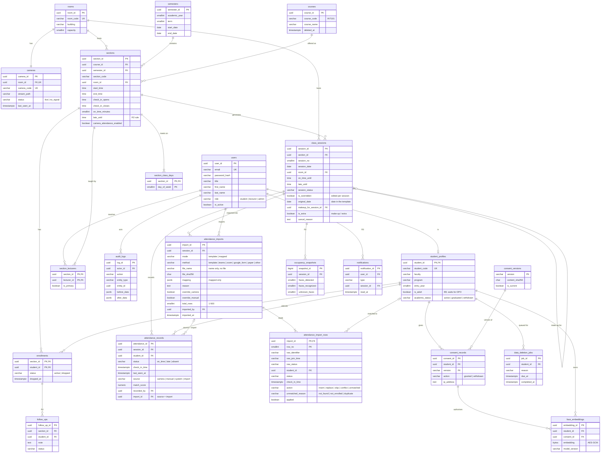

# Database Design — Bangmod Smart Attendance (Release 1)

> สถานะ: **Idea** (ยังไม่ใช่ schema สุดท้าย) · ปรับปรุง 21 พ.ย. 2569 หลังเทียบกับแบบ Sonnet ([comparison](db-design-comparison.md))
> Jira: CP-105 (idea), CP-85 (Conceptual DB Design) · SQL ที่ใช้จริง: [`backend/db/`](../../backend/db/)
> เอกสารต้นฉบับ (แก้ไข/คอมเมนต์ได้): [Database Design (Idea)](https://claude.ai/artifact/85qfBkTYTy2F6RsACQ4K99)

PostgreSQL ของ Release 1 มี **17 ตาราง** ใน 6 กลุ่ม และเตรียมตารางของ R2–R3 ไว้อีก 3 ตาราง + ตารางนำเข้าผลเช็คชื่อจากไฟล์ 2 ตาราง (รวม 22) + 4 view

**หลักการออกแบบ**

- ตารางเรียน ห้อง ช่วงเช็คชื่อ และสวิตช์กล้องผูกที่ `sections` ไม่ใช่ `courses` เพราะ 1 วิชามีหลายกลุ่มที่เรียนต่างห้องต่างเวลา (D1)
- `class_sessions` เก็บสำเนาเวลาและกฎ ณ ตอนสร้างคาบ แก้ตารางเรียนแล้วมีผลเฉพาะคาบที่ยังไม่เริ่ม ผลเช็คชื่อย้อนหลังไม่เปลี่ยน (D2) · คาบที่แก้รายคาบแล้ว (`is_overridden`) แก้ตารางเรียนทีหลังก็ไม่เปลี่ยน
- **ไม่เก็บรูปใบหน้า** เก็บเฉพาะ embedding (เข้ารหัส) และลบจริงเมื่อถอนความยินยอม — ตรงตามข้อความยินยอม v1
- หลักฐานความยินยอมเป็นแบบเพิ่มแถวอย่างเดียว (ให้ / ถอน / ให้ใหม่) ไม่เขียนทับ (D5)
- กลุ่มเสี่ยงไม่เก็บในตาราง คำนวณจากจำนวนครั้งที่ขาด (0–1 Low, 2 Medium, 3+ High)
- PK เป็น `UUID` · ชื่อ `snake_case` · ค่าแบบ enum ใช้ `VARCHAR + CHECK` · เวลาเป็น `timestamptz` (DB timezone `Asia/Bangkok`)

## ER Diagram

คอลัมน์ครบทุกตัว พร้อม constraint และคำอธิบาย อยู่ใน [`backend/db/01_schema.sql`](../../backend/db/01_schema.sql)

## ตารางแต่ละกลุ่ม

| กลุ่ม | ตาราง | หน้าที่ |
|---|---|---|
| 1 ผู้ใช้ | `users` | บัญชีทุก role, login ด้วยอีเมล + BCrypt |
| | `student_profiles` | ข้อมูลนักศึกษา 1:1 กับ users (`student_id` = `user_id`) |
| 2 ห้องและกล้อง | `rooms` | ห้องเรียน |
| | `cameras` | 1 กล้องต่อห้อง, path ใน MediaMTX, สถานะ `live` / `no_signal` |
| 3 รายวิชาและตารางเรียน | `semesters` | ภาคเรียน ใช้กำหนดช่วงสร้างคาบ |
| | `courses` | รายวิชา (soft delete) |
| | `sections` | กลุ่มเรียน: ห้อง เวลา ช่วงเช็คชื่อ กฎตรงเวลา/สาย สวิตช์กล้อง |
| | `section_class_days` | วันเรียนต่อสัปดาห์ (หลายวันได้) |
| | `section_lecturers` | ผู้สอน (ใช้ตรวจสิทธิ์ "เห็นเฉพาะกลุ่มที่สอน") |
| | `enrollments` | นักศึกษาในกลุ่ม + วันถอน |
| | `class_sessions` | คาบแต่ละครั้ง + เลขคาบ + สำเนาเวลา/กฎ + สถานะ + การแก้รายคาบ (เลื่อน / ยกเลิก + เหตุผล / คาบชดเชยหรือคาบพิเศษ) |
| 4 การเข้าเรียน | `attendance_records` | ผลเช็คชื่อ 1 แถวต่อคนต่อคาบ แยกที่มา camera / manual / system / import |
| | `attendance_imports` | การนำเข้าผลเช็คชื่อจากไฟล์ 1 ครั้ง (คาบเดียว · คลาสออนไซต์): วิธี / ชื่อไฟล์ + SHA-256 / คอลัมน์ที่เลือก / เหตุผล / ผู้นำเข้า / จำนวนแต่ละผล · **ไม่เก็บตัวไฟล์** |
| | `attendance_import_rows` | ทุกแถวที่อ่านจากไฟล์: ค่าดิบ, นักศึกษาที่จับคู่ได้, ผลที่ตั้งใจ, ทำอะไร (insert / replace / skip / conflict / unmatched), เขียนจริงไหม (`applied`) |
| 5 ใบหน้าและ PDPA | `consent_versions` | ฉบับข้อความยินยอม + hash |
| | `consent_records` | หลักฐานให้ / ถอนความยินยอม (append-only) |
| | `face_embeddings` | เวกเตอร์ใบหน้า 3–5 ชุดต่อคน ไม่มีรูป |
| | `data_deletion_jobs` | หลักฐานการลบใบหน้าตามกำหนด (D7) |
| 6 ระบบ | `audit_logs` | ใครแก้อะไร: เช็คชื่อด้วยมือ เปิด-ปิดกล้อง ลบใบหน้า ลบวิชา |
| R2 | `follow_ups` | ปุ่ม Follow up ในหน้า At-Risk (ผูกกับ enrollment) |
| R2 | `occupancy_snapshots` | จำนวนใบหน้าในเฟรมระหว่างคาบ สำหรับ Discrepancy Check |
| R3 | `notifications` | แจ้งเตือนลงทะเบียนใบหน้า เตือนก่อนคาบ ยกคลาส ฯลฯ |

Attendance Rules ของ R2 ไม่ต้องมีตารางใหม่ ใช้ `sections.on_time_minutes` และ `sections.late_until`

## กติกาทางธุรกิจ

**จัดสถานะตอนกล้องเห็นครั้งแรก** (ตัวอย่าง Proposal: เปิด 08:45 · ตรงเวลาถึง 09:05 · สายถึง 09:30)

| เวลาที่เห็น | สถานะ | เขียนลง DB |
|---|---|---|
| `check_in_opens` – `on_time_until` | on_time | INSERT `source = camera` |
| หลัง `on_time_until` – `late_until` | late | INSERT `source = camera` |
| หลัง `late_until` | — | ไม่เปลี่ยนสถานะ อัปเดตแค่ `last_seen_at` |
| ปิดช่วงเช็คชื่อ | absent | job INSERT `source = system` ให้คนที่ยังไม่มีแถว |

- กล้องเขียนเฉพาะเมื่อ `camera_attendance_enabled = true` และ consent ล่าสุดเป็น `granted`
- กล้องไม่เขียนทับแถว `manual` และ `import`; อาจารย์แก้ได้ทุกแถวพร้อม `audit_logs`
- `attendanceRate` = (on_time + late) ÷ คาบที่เริ่มแล้ว × 100 (แถว `import` นับเหมือนผลเช็คชื่อปกติ)

**นำเข้าผลเช็คชื่อจากไฟล์** (template ของระบบ หรือไฟล์ Teams / Zoom / Google Form ที่ผู้ใช้เลือกคอลัมน์เอง)

- ลำดับความสำคัญของที่มา: **manual > import > camera > system** · การนำเข้าจะทับแถว `camera` / `manual` ที่มีอยู่หรือไม่ ขึ้นกับตัวเลือก `override_camera` / `override_manual` ที่ผู้นำเข้าเลือก (บันทึกไว้ใน `attendance_imports` · กติกาละเอียดอยู่ฝั่ง Backend — C2)
- แถวที่เขียนจากไฟล์: `source = import`, `import_id` = การนำเข้านั้น (CHECK `(source = 'import') = (import_id IS NOT NULL)`) · `recorded_by` / `reason` = NULL เพราะผู้นำเข้าและเหตุผลอยู่ใน `attendance_imports`
- อาจารย์แก้แถว import ด้วยมือ → กลายเป็น `manual` และล้าง `import_id` · กล้องเห็นคนที่มีแถว import → ไม่เขียน (`import_record`)
- `file_sha256` ใช้เตือนว่าเคยนำเข้าไฟล์เดียวกันในคาบนี้แล้ว · ค่าดิบตัดไม่เกิน 255 ตัวอักษร · ไม่เกิน 500 แถวต่อไฟล์
- **PDPA:** `raw_identifier` ของแถวที่จับคู่ไม่ได้อาจเป็นอีเมล / ชื่อของบุคคลภายนอก (เช่นผู้เข้าร่วม Teams) → เปิดให้เห็นเฉพาะ staff (lecturer / admin) ไม่ส่งให้ student · นโยบายลบ / ระยะเก็บข้อมูลส่วนนี้ทำใน R2

**PDPA**

1. ลงทะเบียน: เรียก AI Service สร้าง embedding ก่อน (นอก transaction) → INSERT `consent_records` (granted) → ลบชุดเดิม → INSERT ชุดใหม่ ใน transaction เดียว (AI ล้มเหลว = ไม่มีแถว consent ค้าง)
2. ถอน (B7): INSERT `consent_records` (withdrawn) → DELETE `face_embeddings` → INSERT `data_deletion_jobs` ที่ `completed_at = now()` → (หลัง commit) แจ้ง AI Service `DELETE /students/{id}/embeddings` ผลอยู่ใน `aiNotified`
3. พ้นสภาพ / สิ้นสุดระบบ: INSERT `data_deletion_jobs` ที่ `due_at = +30 วัน` → job รายวันลบ
4. ประวัติเช็คชื่อก่อนถอนไม่ลบ (ไม่ใช่ข้อมูลใบหน้า)

**แม่แบบ (`sections`) vs คาบจริง (`class_sessions`)** — ฟีเจอร์ "คาบเรียน" (คลาสออนไซต์)

- `sections` = แม่แบบตารางเรียน (วัน / เวลา / ห้อง / ช่วงเช็คชื่อ) · `regenerateSessions` สร้างคาบจริงจากแม่แบบตั้งแต่ตอนนี้ถึงสิ้นภาค เมื่อบันทึกรายวิชา
- แก้คาบรายคาบ → `is_overridden = true` แล้ว regenerate **ไม่ลบและไม่แก้คาบนั้น**:
  - เลื่อนวัน / เวลา / ห้อง: `original_date` = วันที่ตามแม่แบบ (ใส่ครั้งแรกที่เปลี่ยนวัน เลื่อนซ้ำไม่ทับ) → regenerate ไม่สร้างคาบใหม่ในวันเดิม
  - ยกเลิก: `session_status = cancelled` + `cancel_reason` · ไม่ลบผลเช็คชื่อ · คืนคาบได้ (→ `scheduled`) ถ้ายังเป็นอนาคต · คาบที่ยกเลิกจากการลบรายวิชา `cancel_reason` เป็น NULL ได้
  - คาบเพิ่ม: `is_extra = true` (บังคับ `is_overridden` ด้วย CHECK) · `makeup_for_session_id` = คาบที่ชดเชย (NULL = คาบพิเศษ) · คาบที่มีคาบชดเชยอ้างถึง regenerate ก็ไม่ลบ
- regenerate ยังไม่สร้างคาบในวันที่มีคาบอยู่แล้ว (UNIQUE `(section_id, session_date)` นับทุกสถานะรวม cancelled) และเรียง `session_no` ใหม่ตามวันที่ทั้งกลุ่ม (รวมคาบเพิ่ม / คาบที่ยกเลิก)
- สถิติ / view / job ไม่นับคาบ `cancelled` อยู่แล้ว (`STARTED` ใน `DashboardRepository`, `v_room_status`, `v_student_section_attendance` นับเฉพาะ completed, `advanceSessionStatuses`, `insertSystemAbsents`)

**ลบวิชา** — soft delete (`deleted_at`) เพราะผลเช็คชื่ออ้างถึงคาบของวิชานั้น

## หน้าจอ / API → ตาราง

| หน้าจอ | API | ตาราง / view |
|---|---|---|
| Login, Me | `POST /auth/login`, `GET /me` (+B9) | users, student_profiles, `v_face_registration` |
| ลงทะเบียน / จัดการใบหน้า | 5.10, face/status, B7 | consent_records, face_embeddings, data_deletion_jobs |
| หน้าแรก / วิชาของฉัน / ประวัติ | `GET /courses`, attendance ของนักศึกษา | enrollments, sections, courses, class_sessions, attendance_records |
| Room Selection | B1 | `v_room_status` |
| Room Live | B2–B4, 5.7–5.8, เริ่ม / จบคาบ (`POST /rooms/{roomId}/sessions`, `POST /class-sessions/{id}/end`) | cameras, class_sessions, attendance_records, audit_logs (จำนวนใบหน้าในเฟรมมาทาง SSE · จบคาบ = absent `system` ให้คนที่ยังไม่มีผล) |
| Manage / Edit Course | B5, B6 | courses, sections, section_class_days, section_lecturers |
| Registration Status | 5.6 `faceRegistered=false` | enrollments + `v_face_registration` |
| Analytics / At-Risk | 5.4–5.6 | sections, class_sessions, enrollments, attendance_records, `v_face_registration` (backend คำนวณเองใน `DashboardRepository` นับคาบที่เริ่มแล้ว · `v_student_section_attendance` ยังนับเฉพาะ `completed` และยังไม่ได้ใช้) |
| Session Report + เช็คชื่อด้วยมือ | 5.7–5.8, B8 | class_sessions, attendance_records, audit_logs |
| นำเข้าผลเช็คชื่อจากไฟล์ | (C2) | class_sessions, enrollments, attendance_imports, attendance_import_rows, attendance_records |

## คำถามที่ยังเปิดอยู่

- [ ] 1 section มีอาจารย์หลายคน (`section_lecturers`) — แต่ B5 ส่ง `lecturerId` ตัวเดียว
- [ ] แต่ละวันเรียนใช้เวลา/ห้องต่างกันได้ไหม (ถ้าได้ → `section_schedules`)
- [ ] Q5 ลบวิชา: soft delete
- [ ] Q7 เข้ารหัส embedding: AES-GCM ระดับแอป (ต้องตรงกับข้อ 8 ของข้อความยินยอม)
- [ ] Q8 ค่า `session_status`: scheduled / in_progress / completed / cancelled
- [ ] สถานะ "ลา" (`excused`) — Sonnet มี แต่ API v1.0 ไม่มี
- [ ] ชื่อตารางแบบ MS_ / TR_ หรือ snake_case ตรงๆ
- [ ] B9 และระยะเก็บข้อมูล 30 วัน — รอ DPO
- [ ] ระยะเก็บ / ลบ `attendance_import_rows` (ค่าดิบอาจเป็นข้อมูลบุคคลภายนอก) — R2
- [ ] อาจารย์ไม่มี `lecturerCode` / `department` ใน schema (`GET /me` ส่ง null) — เพิ่มคอลัมน์ หรือตัดออกจาก API
